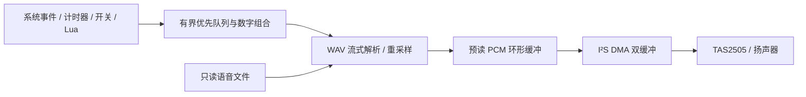

# New Deviation TX15 MAX 语音功能开发计划书

> **For agentic workers:** REQUIRED SUB-SKILL: Use superpowers:executing-plans to implement this plan task-by-task after user review. Steps use checkbox (`- [ ]`) syntax for tracking.

**Goal:** 在原生 TX15 Deviation 中提供兼容 EdgeTX 常用语音资源的非阻塞播报。

**Architecture:** 原生事件队列、流式 WAV/文件读取与 I²S DMA 后端；语音设置独立于现有 NOR 模型/校准保存。

**Tech Stack:** C、STM32H750、TAS2505、I²C4、SPI2/I²S、DMA、SDMMC/FatFs、现有 Lua 5.2 兼容层、ARM GCC 与专用 USB 更新器。

**Spec:** 本文“目标与交付边界”“已核对的现状与约束”“选定架构”“兼容规则与默认行为”共同构成待评审需求基线。

编制日期：2026-10-15；实施更新：2026-10-16。用户已要求按计划推进，A0软件候选已实现并完成检查，用户尚未更新/试听，实际发声、D2 Lua及输入/RF验收仍待完成；A1的WAV/PCM/请求队列离线核心已实现但未启用产品调用，player及A2–A6待实施。[A0记录](../../tx15/audio-a0-2026-10-16.md)，[A1离线记录](../../tx15/audio-core-a1-2026-10-16.md)。范围：原生 Deviation，兼容 EdgeTX 的语音资源与常用播报方式，沿用当前专用 USB 更新流程。

## 目标与交付边界

第一版可用语音的验收目标：从存储介质播放普通话/英语语音包，支持音量、开机提示、微调提示、电压报警、计时器和开关触发播放；播放期间混控、内置 ELRS 与 Lua 菜单继续正常工作。之后补齐数值/单位组合播报、模型专属语音和 Lua 音频 API。

“按照 EdgeTX 标准”分为以下兼容层，不等同于移植 EdgeTX 系统，也不承诺直接导入其整个模型配置：

| 层次 | 本项目目标 |
|---|---|
| 文件格式 | RIFF/WAVE PCM、单声道；先实现 16-bit/32 kHz，再覆盖 16/8 kHz 和 8-bit PCM |
| 目录 | `/SOUNDS/<语言>/SYSTEM/`、语言根目录自定义文件、模型名子目录；普通话优先，英语验证 |
| 系统事件 | 使用对应资源文件名，提供明确的事件映射表 |
| 自定义播报 | 类似 Play Track / Play Value：条件、文件/数值、单次或周期、启用开关 |
| 语言 | 复用语音片段，按语言实现数字与单位组合规则，不在遥控器上运行文本转语音 |
| Lua | 分阶段实现 `playFile`、`playNumber`、`playDuration` 等已声明兼容的接口 |

第一版不包含背景音乐混音、MP3/AAC、麦克风录音、蓝牙音频、所有遥测传感器或任意 EdgeTX Lua 脚本兼容。无对应遥测数据的数值不播报，不能将遥测丢失直接描述成已确认的射频链路中断。

## 已核对的现状与约束

| 项目 | 当前证据 | 对开发的影响 |
|---|---|---|
| 声音输出 | `bench_services.c` 的 SOUND/MUSIC 仍为空函数 | 需要真正的音频后端，启用菜单选项并不能发声 |
| 原 Deviation 扩展语音 | `HAS_EXTENDED_AUDIO=0`；既有扩展方案包含串口播放器路径 | 不直接打开宏套用，避免引入外置串口模块依赖及改变 Model 布局 |
| 音频硬件参考 | 固定 TX15/rm-h750 源码使用 TAS2505、SPI2/I²S、DMA1 Stream4，控制地址 0x18 | 第一阶段对本机进行设备应答、时钟和低音量发声核对，源码参考不等于已验证本机 |
| 共用控制总线 | TX15 的 `AUDIO_I2C=I2C_Bus_1` 实际映射 I²C4 / PD12、PD13；开关扩展器也使用该总线 | 音量/初始化访问需与输入采样调度，禁止为音频随意重置整条总线 |
| 屏幕时钟 | 当前显示驱动使用 PLL3 | 先审计音频核时钟；不得直接覆盖屏幕 PLL3 或改变系统/ELRS 基准 |
| 存储读取 | 当前 `romfs.c` 读取编译内置资源，尚无已验收的 SD/eMMC 文件后端 | WAV 解析可先离线实现，完整语音包依赖文件读取里程碑 |
| 应用区内存 | SWC1 链接图 `_bss_end=0x2407b3c0`，栈从 `0x2407c000` 开始，只余 3136 字节 | 不能直接添加音频缓冲；先划分并验证工作区 |
| 可调整的大块内存 | 当前 Lua heap 160 KiB、RF 参数区约 32 KiB、libc heap 16 KiB | 优先研究经审计的 D2 SRAM 工作区及共享/迁移策略，不盲目缩小 Lua 堆影响 ELRS |
| 加载器约束 | 当前应用验证器只接受既定 CODE 与 RESOURCE 范围 | 不通过添加一个不可加载的 ELF 段绕过检查；第一阶段需证明新工作区由应用初始化且不改变启动契约 |
| 射频调度 | 当前 RC 发布周期定义为 4 ms，样本 100 ms 失效 | 音频/文件读取不得长时间阻塞输入和混控更新；DMA ISR 不做文件读写或解码 |
| 模型/校准 | 当前 v2 模型 3404 字节与校准经 NOR 快照保存 | 第一版保留该结构与设置区域，不为音频重写模型区 |

硬件连线候选：I²S2 MCLK=PC6、WS=PI0、BCLK=PI1、SDO=PI3；TAS2505 reset=PH10，耳机检测=PA5。以上为固定目标资料，实施时核对芯片资料、有效引脚和资源冲突，不能将其他 STM32 遥控器的 DAC 引脚当成 TX15 引脚。只做播放，不配置音频输入。

## 选定架构

2026-10-16存储要求更新：用户希望语音包和模型都存SD卡，目标以SD为两者的主要存储。模型文件目录采用 `/NEWDEVIATION/MODELS/`，语音仍为 `/SOUNDS/<语言>/`；校准和必要设备设置留在机内。新增模型文件读写、校准/模型恢复拆分和现有NOR模型迁移任务，详见[SD存储增补计划](2026-10-16-tx15-sd-model-storage.md)。下文“不为语音改写NOR模型”的原限制继续适用于尚未迁移的音频阶段；后续模型主要存储以本增补要求为准，不把当前固件描述成已经支持SD。

系统继续使用当前 Deviation 主循环和中断机制。音频主循环处理排队、文件预读、解码和填缓冲；DMA 中断只交换已准备的缓冲，欠载填静音并计数。控制总线交易有超时，与开关读取串行调度，不在中断中读 I²C。

建议第一阶段预算：PCM 预读 16 KiB、DMA 双缓冲 4 KiB、队列/解析/工作区不超过 12 KiB，合计上限 32 KiB；这些是目标预算，不是当前空闲内存。必须先释放或迁移 AXI 大块工作区，DMA 缓冲位于经验证可访问、32 字节对齐的 SRAM，排除 DTCM。不得直接修改 CODE 边界侵占现有栈；不引入启动器升级作为默认前置。若现有启动契约下无法取得足够工作区，先回报具体测量和替代方案。

存储策略先做文件只读。2026-10-16用户已选定遥控器内置存储；固定目标资料指向SDMMC1，身份/容量/分区仍需实机只读核对，不能将其称为已验证的可拔TF或eMMC。SOUNDS与模型目录放该内置卷，后续增加USB文件导入/导出入口；当前固件更新工具不支持复制普通文件。详见SD存储增补计划。

为保持 NOR 模型/校准格式，语音设置独立放在所选存储介质的 `/NEWDEVIATION/AUDIO/` 下。设置使用独立版本、序号与 CRC 的 A/B 记录，仅在用户保存时写入，先写未活动副本并读回校验；启动选择最新有效副本，两份损坏时恢复默认并提示。WAV 只读，禁止改写既有 EdgeTX 配置、格式化介质或移动原模型文件。首次启用前保留介质文件备份。

## 兼容规则与默认行为

- 首先保证官方普通话/英语包中的 32 kHz、16-bit、mono PCM 原文件可播放；不要求用户重新录制整套声音。WAV 解析按 chunk 扫描，不能假设所有文件只有固定 44 字节头。
- 下一阶段支持 8/16 kHz PCM 转为统一输出采样率，以及 unsigned 8-bit 到 signed 16-bit 的转换；浮点、压缩、双声道或畸形文件明确拒绝并显示原因，不当作噪声播放。
- 自定义曲目第一版以 6 字符文件名兼容官方手册约定；内置系统文件按官方包实际名称处理，不能因系统文件名超过 6 字符而拒绝。长文件名扩展在文件系统测试后启用。
- 已通过官方仓库目录核对普通话为 `cn`，英语为 `en`，不能把 CSV 的 `zh-CN` 名称直接当作目录。目录示例为 `SOUNDS/cn/SYSTEM/`、`SOUNDS/cn/` 与 `SOUNDS/cn/<模型名>/`；模型名空格转下划线，禁止路径穿越。模型目录 `name.wav` 与开关位置命名按官方约定验证，未实际实现的逻辑开关/飞行模式事件不伪装兼容。
- 官方包的欢迎语仍可能说 EdgeTX。New Deviation 欢迎语使用同格式自有 `hello.wav` 覆盖件；未提供覆盖件时默认不播放品牌欢迎语。其余文件保持标准包结构。
- UI 音量建议 0–20，0=静音，初次硬件测试从低音量开始。语音功能首次默认关闭，用户启用后选择语言、音量、试听；按键音、微调提示和语音分开设置。
- 有界队列初始 16 个请求；告警、计时器、普通提示、Lua 请求分级，紧急请求可打断低优先级播放。连续按键或拨动合并同类未播放提示，不能堆积数分钟的过期提示。队列满拒绝低优先请求并计数，保留紧急告警容量。
- 启动时接收机未上电不连续报“丢失”；只有曾收到有效遥测，再满足失效条件时发一次丢失事件，恢复后才允许下一轮。RSSI/LQ 报警阈值需按实际 ELRS 数据语义配置，不照抄其他协议的 RSSI 数值。
- 第一版音频事件优先接入当前确有数据的遥控器电池、计时器、微调和开关；接收机电压等后续随真实 CRSF 遥测解析接入。
- 缺语音包、文件不存在、读卡超时或音频芯片不应答时停止该语音请求，保留画面提示；已实现的合成提示音独立于语音包。整机仍能启动、编辑模型和发送 RC。

## 分阶段实施与工程量

下表为单人有效工程日估算，假设硬件资料吻合且可获得实机验收窗口；不等同于日历工期或固定报价。第一阶段测量后重估，硬件差异、内存布局及存储介质问题可能使工作量增加。

| 阶段 | 工作与明确产物 | 退出条件 | 估算 |
|---|---|---|---|
| A0 内存与首次发声 | 固定硬件/时钟/总线清单、应用工作区调整、TAS2505 + I²S DMA 最小驱动、合成短提示音 | 低音量可听，重复开关机正常；开关、摇杆、显示及内置 ELRS 未回归 | 2–4 人日 |
| A1 播放核心 | WAV parser、PCM 转换、队列、停止/音量/欠载诊断；先用少量内置测试片段 | 正常/畸形文件检查通过，播放与中断负载可测，无整文件装入 RAM | 3–4 人日 |
| A2 文件读取 | 核对 SD/eMMC 路径，分时文件读取、FAT 只读、目录与路径解析 | 从实际介质播放官方普通话和英语样本，缺卡/慢卡/缺文件可恢复 | 4–7 人日 |
| A3 事件与配置 | Audio 设置/试听、系统事件、开关触发 Play Track、重复规则、独立配置 A/B 保存 | 用户能在遥控器配置，断电重启后保持，原模型与校准保留 | 3–5 人日 |
| A4 数值与模型专属语音 | 普通话/英语数字、正负/小数/时间/单位，Play Value、模型名与位置文件 | 实际电池电压和计时播报正确，模型命名/缺片段规则通过 | 3–5 人日 |
| A5 Lua 音频接口 | 接入同一队列，限定 API、参数/路径/调用预算、兼容性清单 | 测试脚本播放成功，刷屏请求不影响 ELRS Lua 或 RC 调度 | 2–3 人日 |
| A6 联合验收与发布 | 负载、异常、长时间测试，USB 包、说明与语音包检查工具 | 通过下述整机指标，发布可回退更新包与安装步骤 | 3–5 人日 |

总量约 **20–33 人日**；首先争取用 A0 的 **2–4 人日**取得真正可听见的实机反馈。普通语音可用需要 A0–A3，并完成相应整机回归；完整兼容目标按 A4–A6 继续完成。

优先顺序是内存/音频硬件 → 播放核心 → 文件读取 → 系统提示和可配置开关播报 → 数字/计时/单位 → Lua。已有 S1/S2 自动选源属于独立的小功能，不等待语音完成，也不占用语音实机测试轮次。

## 实施接口与文件任务

以下为拟定接口与文件，实施时先用针对性失败测试固定行为，再做最小实现、ARM 构建和一次合并实机验收；不为纯文档修改运行整套固件测试。

### Review Focus

1. 音量写入或音频探测失败时，共用 I²C4 上的开关/微调仍能采样；由 A0 超时与恢复检查覆盖。
2. 音频缓冲、Lua 工作区、栈或显示资源越界/互相覆盖；由 A0 内存图、ARM 链接边界和 Lua 实机回归覆盖。
3. WAV 非固定头、截断、畸形长度和文件路径越界；由 A1 parser 与 A2 路径/介质故障检查覆盖。
4. 语音设置写入中断或模型重命名后错误关联；由 A3 A/B 故障恢复及模型号关联检查覆盖，原 NOR 模型保持不动。
5. 慢卡、连发语音或 Lua 使用时 RC 样本过期；由 A2 异步 I/O、A5 调用预算和 A6 负载验收覆盖。

### A0：工作区、共用总线与音频后端

拟修改 `hardware/tx15/app/app.ld`、`src/target/tx/radiomaster/tx15/lua_tool.c` 的工作区配置；拟新增 `hardware/tx15/board/audio.{h,c}`、`audio_memory.h`。已定位 Lua heap 在 lua_tool.c；不扩大加载器接受地址范围。

- [ ] 列出 `.bss.heap`、RF 参数缓存、USB/显示/SDRAM 区域所有者，给出经验证的 D2 SRAM 预留图、时钟和 32-byte DMA 对齐；保留当前 16 KiB 栈。迁移大块工作区后原 ELRS Lua 页面必须通过实机回归。
- [x] 提供 `int tx15_audio_hw_init(void)`、`void tx15_audio_hw_volume(unsigned level)`、`void tx15_audio_hw_stop(void)`；初始化失败不阻止整机启动。低层 PCM 传输为预分配双缓冲，IRQ 只复制已准备块或填静音，不在 IRQ 访问文件或 I²C。2026-10-16软件检查通过，实机待验收。
- [x] 明确 I²C4 交易锁与超时、PLL/内核时钟所有者、复位仅作用于音频器件；主机故障注入验证交易失败后开关采样仍恢复，实机共用总线效果待测。
- [ ] 测试：寄存器访问顺序/预算、工作区不重叠、对齐、DMA 欠载静音；实机合成提示音、音量、复位重启及原功能回归。通过后提交此阶段。

### A1：解码与队列

拟新增 `src/audio/wav.{h,c}`、`queue.{h,c}`、`player.{h,c}`，测试 `utils/hardware/tests/test_audio_wav.py`、`test_audio_queue.py`。后端契约：`int nd_audio_play(const char *path,unsigned priority,unsigned event_id)`、`void nd_audio_poll(uint32_t now)`、`void nd_audio_stop(void)`；排队调用不做文件读取，只返回是否接受。

- [x] 测试再实现 chunk 边界、奇数长度 padding、额外 LIST/JUNK、截断/溢出、PCM 格式拒绝、8-bit 转换与 8/16 kHz 插值；所有长度用实际读入量约束。2026-10-16离线WAV/PCM检查通过，实际文件服务和播放尚未接入。
- [ ] 固定 16 请求上限、优先级、抢占、同事件合并、停止、采样率转换、超时与静音行为；禁止动态无界分配。
- [ ] 主循环每次处理以 1 ms CPU 时间为初始上限，文件 I/O 不在该函数内同步等待；统计队列峰值、欠载和最坏耗时。目标不达标则先减载，再谈更多功能。

### A2：语音文件后端

拟新增 `hardware/tx15/board/audio_storage.{h,c}`、`src/audio/files.{h,c}`，修改 `runtime.c` 和构建源列表；现有 ROMFS 为其他资源继续保留。

- [ ] 先只读核对实际介质的身份、文件系统与分区，禁止格式化；选择后将介质/挂载规则写入硬件记录。
- [ ] 评估仓库现有 `src/target/drivers/filesystems/FatFs/ff.{h,c}` 的原生目标适配，采用实例化、无重入冲突的文件句柄；不要把目前 ROMFS 的 stdio 包装直接替换成会破坏字体/Lua 内置资源路径的实现。先支持已核对的 FAT32 介质，exFAT 不作为第一版承诺。
- [ ] 文件服务提供有界异步读取；每次最多处理一个 512-byte sector，底层请求进行中必须返回主循环，时间由状态机和截止时间管理。卡等待不阻塞混控样本更新。
- [ ] 支持正确大小写和路径规范，路径上限 128 bytes，拒绝 `..`、绝对盘符和越界；语音读取在 SOUNDS 根目录内，独立配置仅在 NEWDEVIATION/AUDIO 内。
- [ ] 实机读取官方包样本并记录哈希/格式；测试卡慢、无卡、读取途中故障、空文件和缺少 SYSTEM。完成前不宣称整套语音包兼容。

### A3：事件、菜单与独立配置

拟新增 `src/audio/events.{h,c}`、`settings.{h,c}`、`src/pages/320x240x16/audio_page.c`；修改 `runtime.c`、`bench_services.c`、菜单定义和必要的微调/计时事件适配。

- [ ] Audio 菜单提供启用、语言、音量、试听和独立提示音开关；模型播报项提供条件、Play Track/后续 Play Value、单次/不在启动触发/1–60 s 重复及启用状态。第一版每模型最多 16 项，以保留原模型号关联，不以可改名称作为唯一键。
- [ ] 事件请求统一进入队列，不在按键/开关采样或 RF IRQ 直接读音频文件。编写开机、微调中点/极限、计时器和真实遥测失效/恢复的映射检查。
- [ ] 配置 A/B 记录写入、CRC、序号回绕、断电恢复、模型重命名保持关联；不启用改变二进制 Model 结构的 `HAS_EXTENDED_AUDIO` 来实现此功能。
- [ ] 实机一次合并验证试听、音量、开关三档、微调与计时，保存后正常关机重启；注入文件读取错误并确认 RC 继续。

### A4 / A5：数字语法与 Lua

拟新增 `src/audio/numbers.{h,c}`、语言映射、`utils/check-tx15-sounds.py`，修改 `src/lua/runner.{h,c}` 和 API 文档。

- [ ] 普通话与英语分别构造数字片段序列，测试 0、负数、8.18 V、60/61/3599/3600 秒、缺少单位片段与无效遥测；使用现有真实采样值，不能读屏幕字符串猜值。
- [ ] 检查工具读取选定语音包，输出缺失事件、格式不支持和目录问题；不自动改动用户原文件。首次验收固定一个普通话与一个英语包版本/哈希。
- [ ] `playFile(path[,flags])`、`playNumber(value,unit[,attributes])`、`playDuration(seconds[,flags])` 按实施时固定的官方 Lua API 版本逐项核对，单独记录支持范围；语音请求受同一容量/优先级限制，不能以“返回成功但不发声”伪装兼容。
- [ ] 跑现有 ELRS Lua 回归和音频测试脚本；声音相关 API 可用不等于任意 Lua widget 已兼容。

### A6：发布与验收

- [ ] 按当前 `build-tx15-app.py` 产品开关生成 ARM 应用，用 `pack-tx15-update.py` 打包 `.ndu`，检查 loader 可接受范围、镜像和包 CRC；保留原更新器与设置区。
- [ ] 在 CPU/输入/SD/语音负载下监测 `crsf_rc_report`：正常资源播放不增加 `stale`，无接收机失联；RC 间隔以 4 ms 发布设计为基准，验收目标最大间隔不超过 8 ms。100 ms 仅为失效保护，绝不能作为允许卡顿的目标。
- [ ] 正常介质连续播报 30 分钟无欠载、无崩溃；快拨开关、长按微调、Lua 菜单浏览期间输入响应目标不超过 100 ms。故障介质允许停止语音并计数，但 RC 与菜单继续运行。
- [ ] 高优先告警在数据条件满足后 500 ms 内开始；短提示不排长队，静音与停止在 100 ms 内生效。数字组合不被同一等级提示插入而拼成另一句话。
- [ ] 冷启动无卡、缺包、损坏 WAV、配置单份/双份损坏、读取途中失败均能恢复；确认现有模型、校准、SWC1 选源和 MON1 输入监视器未回归。
- [ ] 最后提供固件包、安装目录示例、音频兼容清单、实机证据和回退步骤；每阶段尽量合并成一次用户操作验证，保留软件检查/USB 写入/实机播放/RF 联合验收的独立结论。

## 实施前仍须核对的事项

这些由 A0/A2 的具体核对任务解决，不要求现在额外拆主板或重焊 PWLINK2：本机 TAS2505 设备应答与声音路由；D2 SRAM 的实际可用范围与 DMA 可达性；SDMMC1/2 哪条对应用户使用的介质；选定普通话/英语包版本；音频核时钟和耳机路由。耳机/蓝牙等未验收通道暂不启用。

## 验证命令约定

执行时在 `D:\DEVI移植\deviation` 使用项目 Python，设置 `PYTHONPATH=utils;utils/hardware;utils/hardware/tests;.`。各阶段新增检查模块按以下命令逐步建立，尚未实施的模块现在不存在，不将它们记为已通过：

| 阶段 | 命令（均以项目 Python 执行） |
|---|---|
| A0 | `-m unittest test_audio_hw test_audio_memory test_lua_runtime test_controls test_rf_model` |
| A1 | `-m unittest test_audio_wav test_audio_queue` |
| A2 | `-m unittest test_audio_storage test_audio_files` |
| A3 | `-m unittest test_audio_events test_audio_settings test_calibration_snapshot` |
| A4 | `-m unittest test_audio_numbers` |
| A5 | `-m unittest test_lua_audio test_lua_runtime` |
| A6 | 以上检查及现有 `test_switch_capture test_input_dashboard test_switch_upgrade test_usb_update_package`，然后做实机负载验收 |

所有阶段检查应为 PASS 且退出码 0。ARM 产品构建继续用 `utils/build-tx15-app.py`，启用当前 `TX15_STANDALONE / TX15_ELRS_PRODUCT / TX15_ELRS_RC / TX15_ELRS_LUA / TX15_ELRS_WRITE / TX15_PERSISTENCE=1`；新增原生音频的 `TX15_AUDIO=1` 独立构建开关，默认关闭，仅在该阶段验证后启用。构建输出到各阶段独立 `TX15_BUILD_DIR`，通过后用 `utils/pack-tx15-update.py --build <目录> --output <该阶段.ndu>` 生成应用包。先通过命令与镜像校验，再安排对应的一次实机操作。

## 资料与版本依据

1. [EdgeTX 2.12 彩屏 Storage 文档](https://github.com/EdgeTX/edgetx-user-manual/blob/2.12/color-radios/radio-settings/storage.md)：WAV 资源、采样参数和目录。
2. [EdgeTX 2.12 音频事件约定](https://github.com/EdgeTX/edgetx-user-manual/blob/2.12/edgetx-how-to/advanced-audio-features.md)：系统/模型目录与位置文件命名。
3. [EdgeTX 2.12 Special Functions](https://github.com/EdgeTX/edgetx-user-manual/blob/2.12/color-radios/model-settings/special-functions.md)：播放与条件/重复设置的参照。
4. [官方语音包仓库](https://github.com/EdgeTX/edgetx-sdcard-sounds)、[普通话资源映射](https://github.com/EdgeTX/edgetx-sdcard-sounds/blob/main/voices/zh-CN.csv)：文件名及数字/单位片段，实施时固定具体发布版本，不能把 main 当不可变版本。
5. [固定 rm-h750 音频硬件参考](https://github.com/EdgeTX/edgetx/blob/f5c13ab13ecadf3689c5854cfba51c43646fceec/radio/src/boards/rm-h750/audio_driver.cpp)、[TX15 HAL](https://github.com/EdgeTX/edgetx/blob/f5c13ab13ecadf3689c5854cfba51c43646fceec/radio/src/targets/tx15/hal.h)。仅作为硬件事实参考，沿用项目源码来源/许可核对流程，不把 EdgeTX 框架混入本项目。
6. [TI TAS2505 数据手册](https://www.ti.com/lit/ds/symlink/tas2505.pdf)：器件时钟、I²S、复位和控制接口的依据。

以上兼容与性能数值中，目录/格式/命名来自列明的官方资料；缓冲预算、队列容量、任务分期和性能验收值是本计划提出的工程目标，并非 EdgeTX 的承诺指标。2026-10-15编制时仅交付计划；后续实施以各阶段记录为准，不将软件构建当作扬声器、语音包、文件读取或 Lua 音频实机可用的证明。
